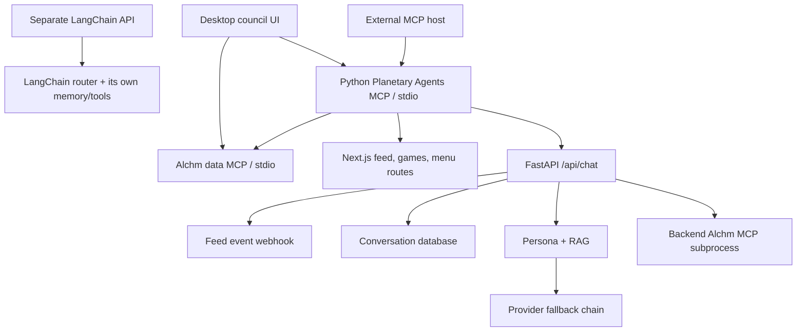

# Project MCP assessment and upgrade recommendations

Date: October 16, 2026. Code baseline: `ca8825e` (October 12, 2026). Scope: the Planetary Agents Python MCP server, its Alchm data-server connection, desktop clients, and adjacent agent execution paths. This is a source-code assessment with isolated behavior checks; it does not establish the deployed version, live traffic, latency, cost, or production incident status.

## Assessment

**Our MCP integration has high domain breadth and moderate interaction depth.** It combines persona responses, live planetary context, ingredient analysis, recipes, games, chart-based interactions, and menu planning. Its main MCP council operation gathers parallel individual stances. The desktop and FastAPI councils add sequential turn-taking, but there is no common durable workflow for planning, assigning work, critique, synthesis, and recovery.

The best next upgrade is a shared execution layer that owns identity, conversation state, permissions, evidence, budgets, and cancellation. More tools should follow that foundation. Keep the project's distinctive personas and deterministic domain calculations; make their orchestration consistent and inspectable.

| Dimension            | Current assessment                                                                                                | Evidence                                                                                                                                                                                                                    |
| -------------------- | ----------------------------------------------------------------------------------------------------------------- | --------------------------------------------------------------------------------------------------------------------------------------------------------------------------------------------------------------------------- |
| Domain/tool breadth  | High: 8 tools, 3 resources, 3 prompts                                                                             | [Python manifests](/Users/cookingwithcastro/Desktop/AlchmAgentsSolana/backend/planetary_agents_mcp_server.py:66)                                                                                                            |
| Tool composition     | Substantial: external data → persona context → parallel stances; chart-triggered dialogue                         | [Debate orchestration](/Users/cookingwithcastro/Desktop/AlchmAgentsSolana/backend/planetary_agents_mcp_server.py:710)                                                                                                       |
| Agent-to-agent depth | Moderate: parallel opinions or sequential contributions; no shared task lifecycle                                 | [Parallel stances](/Users/cookingwithcastro/Desktop/AlchmAgentsSolana/backend/planetary_agents_mcp_server.py:785), [sequential council](/Users/cookingwithcastro/Desktop/AlchmAgentsSolana/backend/main.py:1404)            |
| Autonomy             | Bounded and mostly application-directed; personas do not independently delegate within the MCP workflow           | [Tool handlers](/Users/cookingwithcastro/Desktop/AlchmAgentsSolana/backend/planetary_agents_mcp_server.py:1042)                                                                                                             |
| Memory/identity      | Fragmented: constant MCP persona session IDs, caller-supplied history, separate LangChain memory                  | [MCP chat payload](/Users/cookingwithcastro/Desktop/AlchmAgentsSolana/backend/planetary_agents_mcp_server.py:599), [router singleton](/Users/cookingwithcastro/Desktop/AlchmAgentsSolana/lib/langchain/agent-router.ts:291) |
| Operational maturity | Useful telemetry, fallback, retries, and release checks; several success and compatibility signals are misleading | [Invocation logging](/Users/cookingwithcastro/Desktop/AlchmAgentsSolana/backend/mcp_invocation_log.py:206), [probe verdict](/Users/cookingwithcastro/Desktop/AlchmAgentsSolana/backend/main.py:2203)                        |

These are qualitative judgments, not measured scores. A large persona catalog is different from a large number of independently executing agents.

## What is actually connected

The diagram shows logical paths; Alchm subprocess instances can exist in different processes. The desktop starts both stdio clients, and PA forwards chat over HTTP. FastAPI independently hydrates chat through its own Alchm client. Therefore, **a local MCP process does not imply local inference or offline operation**. [Desktop startup](/Users/cookingwithcastro/Desktop/AlchmAgentsSolana/desktop-shell/src/main.ts:750), [HTTP forwarding](/Users/cookingwithcastro/Desktop/AlchmAgentsSolana/backend/planetary_agents_mcp_server.py:628), [backend hydration](/Users/cookingwithcastro/Desktop/AlchmAgentsSolana/backend/main.py:390)

### Advertised Python surface

| Tool                               | Actual role and boundary                                                                                       |
| ---------------------------------- | -------------------------------------------------------------------------------------------------------------- |
| `chat_with_planetary_agent`        | Fetches sky context; forwards one persona request to FastAPI; returns text and metadata                        |
| `list_planetary_agents`            | Queries the backend catalog/search, with optional local database fallback and post-fetch filtering             |
| `get_agent_feed_discussion`        | Downloads the feed and searches its current events for an ID                                                   |
| `synthesize_culinary_debate`       | Fetches ingredient/sky/recipe data; optionally detects a Jing interaction; requests one stance per participant |
| `trigger_chart_specific_jing_duel` | Uses natal-chart synastry to generate two in-character voices                                                  |
| `play_agent_word_duel`             | Forwards game input to the frontend Word Duel route                                                            |
| `play_jing_arena_move`             | Forwards game input to the frontend Jing route                                                                 |
| `plan_weekly_menu`                 | Generates a menu and, by default, attempts to complete and share it                                            |

The three resources are sky transits, an agent catalog overview, and Jing counter rules. The three prompts are culinary debate, philosophical council, and elemental clash. Prompts are message templates, not independent running agents. The catalog resource is a hardcoded overview; the discovery tool fetches backend records. [Manifests](/Users/cookingwithcastro/Desktop/AlchmAgentsSolana/backend/planetary_agents_mcp_server.py:66), [resource implementation](/Users/cookingwithcastro/Desktop/AlchmAgentsSolana/backend/planetary_agents_mcp_server.py:1077)

### How intricate is a debate?

The MCP debate gathers ingredient analysis and sky context, then recipes, optionally adds chart interaction context, and concurrently asks each participant for a two-to-three-sentence stance. The handler caps participants at six; anonymous/standard gating reduces the debate to one. Participants receive the same opening prompt and shared context, not the other participants' generated stances. The returned `dialogue` is a collection of responses, with no subsequent critique or synthesis stage. [Debate](/Users/cookingwithcastro/Desktop/AlchmAgentsSolana/backend/planetary_agents_mcp_server.py:710), [gating](/Users/cookingwithcastro/Desktop/AlchmAgentsSolana/backend/mcp_invocation_log.py:119)

FastAPI's separate council route and desktop council instead pass earlier contributions to later speakers. That creates a conversational relay. Neither path establishes a shared durable task state or convergence condition. The Alchm Python bridge also serializes requests through one lock, so scheduling parallel data tasks does not guarantee parallel work downstream. [FastAPI council](/Users/cookingwithcastro/Desktop/AlchmAgentsSolana/backend/main.py:1404), [desktop council](/Users/cookingwithcastro/Desktop/AlchmAgentsSolana/desktop-shell/src/main.ts:5243), [bridge lock](/Users/cookingwithcastro/Desktop/AlchmAgentsSolana/backend/alchm_mcp.py:362)

## Strengths worth preserving

- **Clear domain split:** PA supplies persona reasoning; the Alchm server supplies deterministic data through a five-tool allowlist. [Bridge contract](/Users/cookingwithcastro/Desktop/AlchmAgentsSolana/backend/alchm_mcp.py:13)
- **Graceful degradation:** data failures can leave persona/RAG responses available; subprocess launch failures have exponential cooldown. [Hydration](/Users/cookingwithcastro/Desktop/AlchmAgentsSolana/backend/main.py:390), [launch breaker](/Users/cookingwithcastro/Desktop/AlchmAgentsSolana/backend/alchm_mcp.py:267)
- **Operational groundwork:** persistent invocation records, tier-downgrade aggregation, latency percentiles, scheduled probes, and desktop retry/reconnect diagnostics already exist. [Logging](/Users/cookingwithcastro/Desktop/AlchmAgentsSolana/backend/mcp_invocation_log.py:148), [summary](/Users/cookingwithcastro/Desktop/AlchmAgentsSolana/backend/main.py:2420), [client tests](/Users/cookingwithcastro/Desktop/AlchmAgentsSolana/test/desktop-shell/local-mcp-client.spec.ts:113)
- **A distributable desktop boundary:** stdio and the packaged sidecar are useful. Modernizing the implementation does not require moving all access to a hosted MCP endpoint. [Packaging](/Users/cookingwithcastro/Desktop/AlchmAgentsSolana/backend/pyproject.toml:1)

## Findings and recommended upgrades

### 1. Make identity and permissions authoritative at the API boundary — highest priority

The MCP dispatcher resolves a key and entitlement locally, but `_backend_chat` sends neither that verified identity nor an authorization credential to FastAPI. It assigns every caller of the same persona the session ID `mcp-{agent_id}`. The `/api/chat` route itself has no route-level caller authentication; its tier resolver clamps against server configuration rather than the caller's verified entitlement. The exposed Alchm tool proxy similarly has no route-level caller check, although its underlying bridge restricts calls to five names. Deployment gateway protections were not inspected. [Dispatch](/Users/cookingwithcastro/Desktop/AlchmAgentsSolana/backend/planetary_agents_mcp_server.py:1231), [chat forwarding](/Users/cookingwithcastro/Desktop/AlchmAgentsSolana/backend/planetary_agents_mcp_server.py:620), [API entry](/Users/cookingwithcastro/Desktop/AlchmAgentsSolana/backend/main.py:882), [tier clamp](/Users/cookingwithcastro/Desktop/AlchmAgentsSolana/backend/main.py:163), [tool proxy](/Users/cookingwithcastro/Desktop/AlchmAgentsSolana/backend/main.py:516)

**Upgrade:** resolve actor and entitlements on the trusted backend; propagate a scoped credential from the desktop/stdio environment. Generate conversation IDs and bind them to authenticated user + conversation + agent. Reject attempts to access another user's state. Do not trust a model-supplied `userId`, tier, or context as authority. Apply per-user concurrency, request, and spend limits at this same boundary.

The key resolver checks `isActive` but not the model's `expiresAt`, and database keys are stored as directly comparable tokens. Frozen sidecars deliberately use local SQLite, which cannot independently validate cloud database keys. Use remote entitlement validation, expiry enforcement, rotation, and hashed key storage. Account-holder access to the `alchemist` tier is intentional in the current code; clarify that policy rather than assuming subscription-only access. [Resolver](/Users/cookingwithcastro/Desktop/AlchmAgentsSolana/backend/mcp_invocation_log.py:26), [key model](/Users/cookingwithcastro/Desktop/AlchmAgentsSolana/backend/models.py:135), [sidecar database](/Users/cookingwithcastro/Desktop/AlchmAgentsSolana/backend/database.py:80)

**Acceptance:** two users can converse with the same persona without sharing identifiers or state; expired keys fail; direct HTTP calls cannot bypass policy. The constant session ID is a confirmed design defect, not proof that cross-user content has been disclosed.

### 2. Separate generation from external writes — highest priority

`plan_weekly_menu` defaults to `completed`, defaults sharing to true, and forces regeneration. A normal planning call therefore attempts a write/share workflow. The chat path also emits feed events containing message and response previews, subject to webhook configuration and delivery. These effects deserve explicit visibility and ownership rules. [Menu defaults](/Users/cookingwithcastro/Desktop/AlchmAgentsSolana/backend/planetary_agents_mcp_server.py:812), [menu routes](/Users/cookingwithcastro/Desktop/AlchmAgentsSolana/app/api/menu-planner/weekly/route.ts:37), [chat feed emission](/Users/cookingwithcastro/Desktop/AlchmAgentsSolana/backend/main.py:1328), [feed emitter](/Users/cookingwithcastro/Desktop/AlchmAgentsSolana/backend/feed_emitter.py:1)

**Upgrade:** make menu planning create a draft; expose a separate scoped publication operation. Require an idempotency key and an authorized actor for publication/regeneration. Add a conversation visibility setting that controls feed emission and defaults private for private chats. Advertise accurate tool side-effect annotations; annotations supplement server enforcement.

**Acceptance:** retries cannot duplicate publications, planning does not publish, and a private conversation produces no public preview.

### 3. Fix false success and release drift — immediate, relatively small work

Two issues were reproduced from tracked source without production access:

- The synthetic probe returns `success: true` when both tool calls return MCP `result.isError: true`; it checks only top-level errors. The scheduled workflow also treats HTTP 200 as success without inspecting the result body. [Probe](/Users/cookingwithcastro/Desktop/AlchmAgentsSolana/backend/main.py:2203), [workflow](/Users/cookingwithcastro/Desktop/AlchmAgentsSolana/.github/workflows/synthetic-mcp-probe.yml:76)
- The sidecar release smoke test asserts exactly four tools, while the server advertises eight. This is a source-level release-gate mismatch, not a claim about the latest CI run. [Assertion](/Users/cookingwithcastro/Desktop/AlchmAgentsSolana/.github/workflows/sidecar-release.yml:86)

Separately, the debate can return a normal successful tool envelope even when every participant fails: each exception becomes a dialogue item, and the final result lacks `isError`. The packaging whitelist omits `secure_compare`, which the shipped invocation logger imports unconditionally. [Debate error handling](/Users/cookingwithcastro/Desktop/AlchmAgentsSolana/backend/planetary_agents_mcp_server.py:785), [package whitelist](/Users/cookingwithcastro/Desktop/AlchmAgentsSolana/backend/pyproject.toml:48), [import](/Users/cookingwithcastro/Desktop/AlchmAgentsSolana/backend/mcp_invocation_log.py:9)

The wheel also intentionally excludes `crud`, yet natal-chart lookup imports it. Lookup failures become missing charts, which can produce a misleading “no close aspects” result. Retrieve charts through a backend service and distinguish unavailable charts from a valid calculation finding no aspect. The built sidecar's module contents need separate verification. [Packaging choice](/Users/cookingwithcastro/Desktop/AlchmAgentsSolana/backend/pyproject.toml:41), [natal lookup](/Users/cookingwithcastro/Desktop/AlchmAgentsSolana/backend/planetary_agents_mcp_server.py:355), [duel outcome](/Users/cookingwithcastro/Desktop/AlchmAgentsSolana/backend/planetary_agents_mcp_server.py:478)

**Upgrade:** define `ok`, `partial`, `failed`, and `cancelled` domain outcomes, mapping total tool failure to `isError`. Check semantic provider/data outcomes in probes. Generate the manifest used by docs and release checks from the same registry. Add a clean-wheel install and packaged-binary tool-call test, beyond initialization.

**Acceptance:** all-agent failure and missing required data make probes fail; the clean installed package boots outside the checkout; each advertised tool has a mocked successful and failed round trip.

### 4. Replace handwritten protocol plumbing with typed contracts

The server defaults to MCP `2025-06-18` and manually implements dispatch and newline framing. All eight tools return JSON within text content, lack output schemas and annotations, and lack schema-level string/list size bounds. Some handlers do apply manual limits, so this is not an absence of all validation. The main loop finishes each call before reading the next, preventing that loop from consuming cancellation while work is active. [Protocol default](/Users/cookingwithcastro/Desktop/AlchmAgentsSolana/backend/planetary_agents_mcp_server.py:17), [schemas](/Users/cookingwithcastro/Desktop/AlchmAgentsSolana/backend/planetary_agents_mcp_server.py:66), [main loop](/Users/cookingwithcastro/Desktop/AlchmAgentsSolana/backend/planetary_agents_mcp_server.py:1349)

**Upgrade:** introduce typed domain request/result models and an official Python SDK adapter. Publish `outputSchema` and `structuredContent`, retaining compatible text output. Validate types, enums, sizes, unknown fields, and outputs. Share or generate TypeScript contracts. Keep stdout protocol-only; use stderr and correlated tracing for diagnostics.

Improve discovery alongside the contracts: apply sign/archetype filters before limiting the backend query, return cursor-based catalog pages, and retrieve feed threads directly by ID. Current filters run after a limited fetch, while thread lookup searches only the downloaded feed; both can miss existing records. Make the catalog resource derive from the same canonical inventory. [Catalog filtering](/Users/cookingwithcastro/Desktop/AlchmAgentsSolana/backend/planetary_agents_mcp_server.py:879), [feed lookup](/Users/cookingwithcastro/Desktop/AlchmAgentsSolana/backend/planetary_agents_mcp_server.py:676)

As checked on the report date, the official latest protocol is **2026-07-28**, and the official Python SDK documents stable v2 with `MCPServer` and Python 3.11+. That protocol changes discovery and per-request metadata. **Changing the version environment variable alone is not a migration.** Pin a tested SDK and upgrade the desktop client and packaged sidecar together, retaining tested legacy compatibility. [Official changelog](https://modelcontextprotocol.io/specification/2026-07-28/changelog), [SDK v2](https://py.sdk.modelcontextprotocol.io/whats-new/), [SDK repository](https://github.com/modelcontextprotocol/python-sdk)

**Acceptance:** the actual desktop client and an independent SDK client pass discovery/legacy compatibility, malformed input, framing, concurrent requests, cancellation, and shutdown checks against the binary.

### 5. Add one execution lifecycle and evidence snapshot

PA can fetch sky data before chat, then FastAPI fetches it again during hydration. Debate supplies ingredient/recipe data, but individual chat requests can rehydrate those sources too. The bridge serializes requests; its timeout applies to each read rather than a complete operation. Desktop transport retries and several fallback paths add further layers. These are sources of duplicate work and inconsistent timing; no latency benchmark was performed. [PA prefetch](/Users/cookingwithcastro/Desktop/AlchmAgentsSolana/backend/planetary_agents_mcp_server.py:648), [backend hydration](/Users/cookingwithcastro/Desktop/AlchmAgentsSolana/backend/main.py:1284), [bridge deadline](/Users/cookingwithcastro/Desktop/AlchmAgentsSolana/backend/alchm_mcp.py:378), [desktop fallback](/Users/cookingwithcastro/Desktop/AlchmAgentsSolana/desktop-shell/src/main.ts:5331)

**Upgrade:** use one execution context carrying verified actor, request/conversation/run IDs, a total deadline, cancellation signal, granted capabilities, budget, and a server-created evidence snapshot ID. Reuse sky/ingredient/recipe evidence across participants, with observation time and freshness policy. Bound concurrency; retry reads selectively and mutations only with idempotency. Propagate cancellation into HTTP, model, and child work.

The child launch currently copies the complete environment and falls back to an unpinned npm package. Pin the package and pass only required environment variables and least-privilege data credentials. [Launch](/Users/cookingwithcastro/Desktop/AlchmAgentsSolana/backend/alchm_mcp.py:23), [child environment](/Users/cookingwithcastro/Desktop/AlchmAgentsSolana/backend/alchm_mcp.py:290)

**Acceptance:** one council run uses one identified evidence snapshot; a cancelled call stops downstream work while catalog reads remain responsive; retries do not double-charge or republish.

### 6. Deepen interaction with a bounded council workflow

Add a `run_council` capability after the foundation above. Preserve existing tools as convenience entry points. Suggested workflow:

1. Select a small roster with declared roles and reasons for selection.
2. Gather a shared, cited evidence snapshot once.
3. Collect independent initial proposals with bounded parallelism.
4. Run one critique round addressing specific proposals.
5. Produce a synthesis that records agreement, unresolved disagreement, and evidence references.
6. Persist the result and step outcomes under an owned run ID.

Start with two rounds, at most three participants by default, a strict token/spend ceiling, and explicit termination. These are proposed starting limits, not measured optimal settings. Persist structured messages and outcomes rather than a concatenated transcript alone. Expose status/cancel/resume only with ownership checks. Use deterministic rules for game legality and calculations; use model output for voice, proposals, and interpretation.

Evaluate whether critique changes the final recommendation, whether citations support claims, whether roles remain distinct, whether outputs respect game/domain constraints, and whether budgets hold. Agent count and theatrical dialogue length are weak measures of useful collaboration.

For long work, start with ordinary owned workflow handles. Adopt the official Tasks extension only when both desktop and intended MCP hosts support it; treat rollout as experimental for this project until tested. A Python background task alone is not durable execution. [Tasks extension](https://modelcontextprotocol.io/extensions/tasks/overview)

### 7. Consolidate adjacent surfaces before enabling more autonomy

The separate LangChain API uses a process-global router whose first configuration and memory persist across requests. It injects twelve tools, including external write capabilities, without a shared actor/ownership context. Its coordinator tool recommends personas rather than executing a council; its retrieval tool returns placeholder statistics. No frontend caller was found in tracked code, so treat it as a separate reachable route rather than the default MCP engine. [API](/Users/cookingwithcastro/Desktop/AlchmAgentsSolana/app/api/langchain-agent/route.ts:73), [singleton](/Users/cookingwithcastro/Desktop/AlchmAgentsSolana/lib/langchain/agent-router.ts:291), [tool injection](/Users/cookingwithcastro/Desktop/AlchmAgentsSolana/lib/langchain/agent-router.ts:150), [coordinator/retrieval](/Users/cookingwithcastro/Desktop/AlchmAgentsSolana/lib/langchain/agent-tools.ts:242)

The Rust MCP port advertises nine tools, six explicitly implemented as degraded placeholders. The Galileo integration wrapper has no callers found in tracked code and includes synthetic timing, so it is not evidence of live MCP tracing. [Rust handlers](/Users/cookingwithcastro/Desktop/AlchmAgentsSolana/pa-rust-backend/src/mcp/mod.rs:237), [Galileo timing](/Users/cookingwithcastro/Desktop/AlchmAgentsSolana/lib/galileo-agent-mcp-integration.ts:82)

**Upgrade:** route active surfaces through the same identity, memory, permission, and execution services. Scope LangChain executors by user/session; remove or clearly mark placeholders. Maintain a capability matrix for Python, Rust, desktop, and external hosts. Return actual execution-source and fallback metadata.

The desktop network switch is checked around direct cloud fallback, while MCP/private-context paths can run outside that check and target cloud services. This is a code-path risk, not a verified offline-mode incident. Enforce network policy inside the execution boundary and test with outbound access denied. Move persisted API keys from localStorage to OS credential storage. [Network policy](/Users/cookingwithcastro/Desktop/AlchmAgentsSolana/desktop-shell/src/main.ts:803), [MCP-before-fallback path](/Users/cookingwithcastro/Desktop/AlchmAgentsSolana/desktop-shell/src/main.ts:5351), [private context](/Users/cookingwithcastro/Desktop/AlchmAgentsSolana/desktop-shell/src/main.ts:4965), [persistence](/Users/cookingwithcastro/Desktop/AlchmAgentsSolana/desktop-shell/src/main.ts:1247)

### 8. Make observability reflect real outcomes and private-data boundaries

Existing summaries are valuable, but per-tool p95, requested/granted/actual model tiers, child errors, fallback source, and evidence freshness need a shared trace. A single global two-second p95 threshold mixes fast catalog reads with model generation. Invocation logging keeps arguments/history/context while redacting only two `_meta` key spellings. Background writes are retained by reference, but shutdown does not explicitly drain them. [Summary thresholds](/Users/cookingwithcastro/Desktop/AlchmAgentsSolana/backend/main.py:2529), [redaction](/Users/cookingwithcastro/Desktop/AlchmAgentsSolana/backend/mcp_invocation_log.py:167), [write lifecycle](/Users/cookingwithcastro/Desktop/AlchmAgentsSolana/backend/mcp_invocation_log.py:221), [shutdown](/Users/cookingwithcastro/Desktop/AlchmAgentsSolana/backend/planetary_agents_mcp_server.py:1387)

**Upgrade:** correlate desktop → MCP → HTTP → provider/tool spans; record real durations, outcome, budget usage, snapshot age, and fallback. Set service objectives by operation class after measuring a baseline. Log selected metadata rather than full prompts by default; support explicit retention/deletion and bounded shutdown flushing. The current SDK supports OpenTelemetry, while the 2026 protocol deprecates protocol logging; prefer stderr and OTel for new instrumentation. [SDK tracing](https://py.sdk.modelcontextprotocol.io/run/opentelemetry/), [protocol changes](https://modelcontextprotocol.io/specification/2026-07-28/changelog)

## Recommended delivery order

| Order | Deliverable                                                                          | Exit condition                                                                |
| ----- | ------------------------------------------------------------------------------------ | ----------------------------------------------------------------------------- |
| 1     | Correct probes, tool-manifest checks, and package closure                            | Failed tools fail probes; wheel and binary pass real tool-call smoke tests    |
| 2     | Verified identity, owned sessions, scoped mutations, key expiry, private feed policy | Isolation and authorization checks pass across MCP and direct HTTP            |
| 3     | Shared typed contracts, official SDK adapter, tested compatibility                   | Existing clients retain behavior; malformed/oversized input fails before work |
| 4     | Shared execution context, evidence reuse, cancellation, budgets, tracing             | Responsive concurrent reads; bounded work; complete correlated outcomes       |
| 5     | Durable bounded council with critique and synthesis                                  | Useful multi-round results, owned resumable state, reproducible budget limits |
| 6     | Optional Tasks extension or remote MCP adapter                                       | Demonstrated client need and interoperability/ownership/restart tests         |

Identity and externally visible mutation controls should block broader exposure or greater autonomy. Small release/probe fixes can proceed in parallel. No hosted MCP conversion is required: MCP OAuth applies to HTTP; stdio credentials should originate in the trusted runtime environment and authenticate downstream access. [Authorization specification](https://modelcontextprotocol.io/specification/2026-07-28/basic/authorization)

## Validation and limitations

- Parsed tracked Python source: confirmed exactly **8 tools, 3 resources, 3 prompts** and the release assertion mismatch.
- Executed the extracted, unchanged synthetic probe with mocked imports and both MCP tools returning `isError: true`: confirmed it returns `success: true`. No network/database access occurred.
- Independently executed the server with stub dependencies: confirmed all-participant debate failures retain a normal result envelope, and unknown tools map to internal error `-32603`.
- Reviewed Python handler tests, opt-in stdio roundtrip, admin-summary tests, desktop client tests, and release/scheduled workflows. Default backend CI runs pytest, but the stdio test requires `PA_MCP_E2E=1`; the release smoke test currently checks initialization/listing and the stale count. [Stdio test](/Users/cookingwithcastro/Desktop/AlchmAgentsSolana/backend/tests/test_mcp_stdio.py:47), [backend CI](/Users/cookingwithcastro/Desktop/AlchmAgentsSolana/.github/workflows/ci.yml:118)
- Focused pytest/Vitest runs were attempted but did not complete because local file reads stalled; the available system Python also lacks the backend runtime dependencies. No suite pass, production health result, or performance figure is claimed. Tracked Git source was used where filesystem reads stalled; the initial working tree was clean.
- Current MCP/SDK recommendations were checked against official sources. See the companion [protocol research memo](/Users/cookingwithcastro/Desktop/AlchmAgentsSolana/docs/development/mcp-protocol-upgrade-research-2026-10-16.md) for version-specific details and additional citations.

Only assessment documents were added. No application code, deployment, credentials, or external content was changed.
